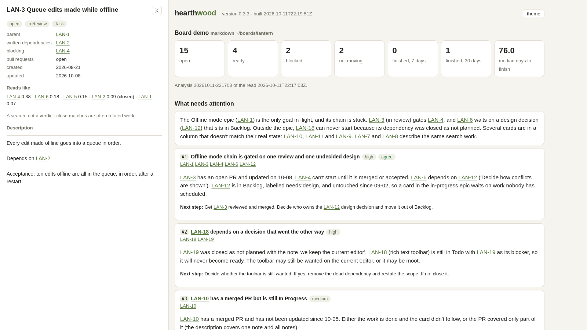

# hearthwood

A companion for project managers who look after a board. It reads your board, works out
what is ready, what is stuck and why, and what deserves your attention, then asks what you
think. Your answers become your **criteria**, and every later reading follows them.

Hearthwood **reads only**. It never writes to your board. When it suggests a change, you
approve or reject it, and it remembers which.

```
 your board ──read──► snapshot ──► facts (plain code) ──► reading (Claude) ──► you
                                        ▲                       ▲               │
                                        └──── criteria.md ◄─────┴── verdicts ◄──┘
```



It is the sister of [hearthwork](https://github.com/alexandr352/hearthwork), which runs
development tickets. Hearthwood looks after the board those tickets live on.

## What it does

- **Reads a board.** It reads GitHub issues and a GitHub Projects board. It also reads a folder
  of markdown tickets, which is how the demo works. Jira is next. Everything is kept as a snapshot
  on your machine, so an analysis can always be looked at again and argued with.
- **Works out the facts with plain code first.** What is ready to start, with every dependency
  finished. What is blocked, and by what. What has not moved in a week. Where the board and the
  pull requests disagree. Loops, duplicates, goals with nothing left in them. Each fact comes with
  an id and a sentence saying why. [How it works](docs/how-it-works.md) lists every rule.
- **Has Claude read it once.** The reading gets the facts and your criteria. It may open any
  ticket in the snapshot. It says what needs your attention, most important first. It asks what
  the board cannot tell it, and proposes changes. Its answer is checked by code: every ticket it
  names must exist, and every fact it cites must be real. An answer that fails goes back to the
  same session with the problem named.
- **Learns how you judge.** You agree or disagree with each point and give your reason in a
  line. A reason you would apply again becomes a rule in `criteria.md`, in your words, and it
  outranks the reading's defaults from then on.
- **Shows it all on one page.** `~/.hearthwood/log.html` is a static page with no server.
- **Has a spirit to talk to.** `manager chat` opens a Claude Code session that knows the home
  and walks through an analysis with you.

## What it does not do

- It does not write to your board. This is version 0.1, so approving a proposal records your
  decision and prints the change for you to make by hand.
- It does not judge people. It looks at the work. Assignees stay out of everything unless you
  turn `people = true` on for a board, and even then it shows load, never a score. See
  [People and privacy](docs/people-and-privacy.md).
- It sends nothing anywhere on its own. The one exception is the reading, which hands the facts
  and the ticket text to Claude, as any Claude Code session would.

## Install

You need Python 3.10 or newer, and the [Claude Code](https://claude.com/claude-code) CLI
(`claude`), logged in.

```sh
python3 -m venv ~/.hearthwood-venv
~/.hearthwood-venv/bin/pip install git+https://github.com/alexandr352/hearthwood
echo 'export PATH="$HOME/.hearthwood-venv/bin:$PATH"' >> ~/.zshrc   # ~/.bashrc on bash
source ~/.zshrc
manager init
manager doctor
```

To update, run the `pip install` line again with `--upgrade`.

While the repository is private, `pip` needs your access to it. Either use
`git+ssh://git@github.com/alexandr352/hearthwood` if you have an SSH key on GitHub, or clone the
repository and run `pip install /path/to/hearthwood`.

## Try it on the demo board

The demo is an imaginary notes app with twenty made-up tickets. They cover a stuck chain of
work, a ticket blocked by work that was cancelled, a merged pull request on an open card, two
near-duplicates, and more.

```sh
git clone https://github.com/alexandr352/hearthwood && cd hearthwood
manager connect markdown examples/demo-board --board demo
manager read
manager analyze --facts-only     # the facts alone: no model call, no cost
manager analyze                  # the facts, then one reading (about $0.10 with Sonnet)
manager review                   # agree or disagree, one point at a time
manager log --open
```

## Use it on your GitHub board

```sh
manager connect github --board web --repo your-org/your-repo --project 3
manager read
manager analyze
```

`--project` is the number in your Projects board's URL. Leave it out to read issues only.
You paste the token once and it is kept in a file only you can read. A fine-grained,
read-only token is enough. [Connecting](docs/connecting.md) explains exactly which permissions
to give it, and what changes when the token cannot read the Projects board.

Check `~/.hearthwood/boards/web/board.toml` once. It says which of your columns mean "waiting",
"in progress", "in review", "done" and "parked", which labels block work, and how long work can
sit before it counts as not moving.

## The daily loop

```sh
manager analyze --read           # a fresh snapshot, the facts, one reading
manager review                   # your verdicts; keep the good reasons as rules
manager criteria                 # what you have taught it so far
```

`manager next` always names the one next step. `manager status` says where things stand.

## Cost

`manager read` and `manager analyze --facts-only` call no model and cost nothing. A reading is
one Claude Code session:

| board | model | time | cost (API-equivalent) |
| --- | --- | --- | --- |
| the demo board, 20 tickets | Sonnet | 37 s | $0.10 |
| a real board, 724 issues (527 open) | Sonnet | 32 s | $0.18 |

The default reading model is Opus, which costs more and reads more carefully. Set
`analyst = "sonnet"` under `[models]` in `~/.hearthwood/config.toml` to change it, or use
`manager analyze --model sonnet` for a single run. On a Claude subscription the cost comes out of
your usage limits, not out of money. Every call is listed on the page.

## Documentation

- [Commands](docs/commands.md): every command and its options.
- [How it works](docs/how-it-works.md): the snapshot, every rule, the reading and its contract,
  and the fence.
- [Connecting](docs/connecting.md): GitHub tokens and permissions, the markdown format, and Jira
  (planned).
- [Criteria](docs/criteria.md): how verdicts become rules, and how to share what you have taught it.
- [Finding duplicates](docs/experiments/duplicate-search.md): an experiment on a real board, full-text
  search against embeddings, and what hearthwood does with the result.
- [People and privacy](docs/people-and-privacy.md): what is read, what leaves your machine, and
  what never does.
- [Contributing](CONTRIBUTING.md) and [Changelog](CHANGELOG.md).

## License

MIT. See [LICENSE](LICENSE).
